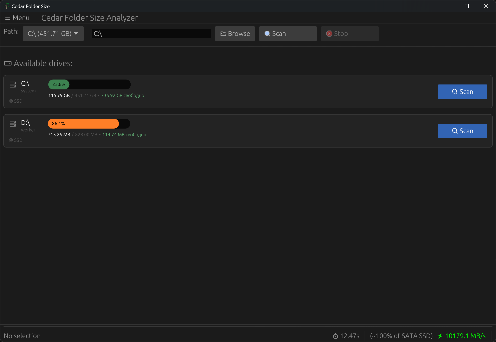
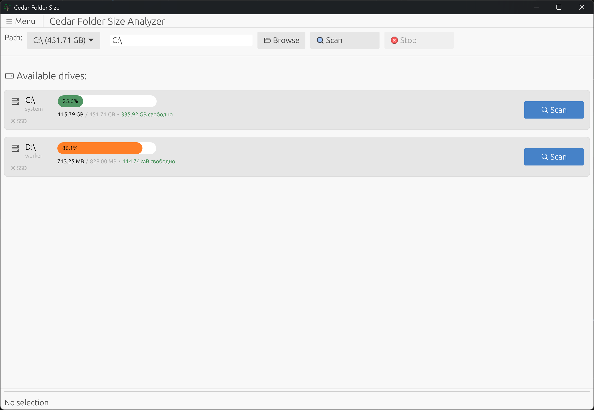
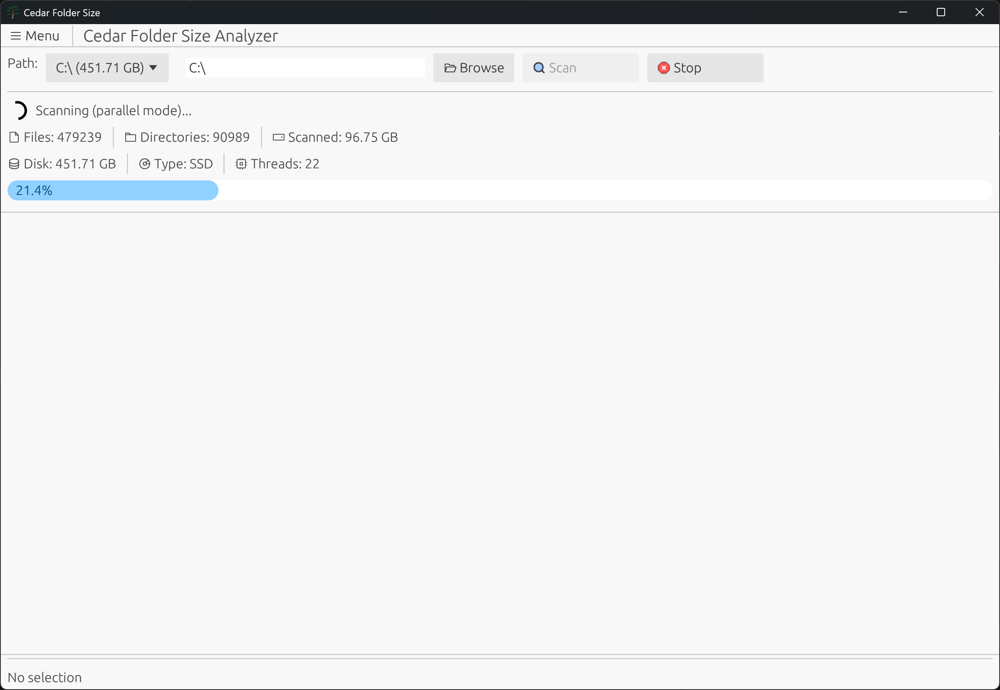
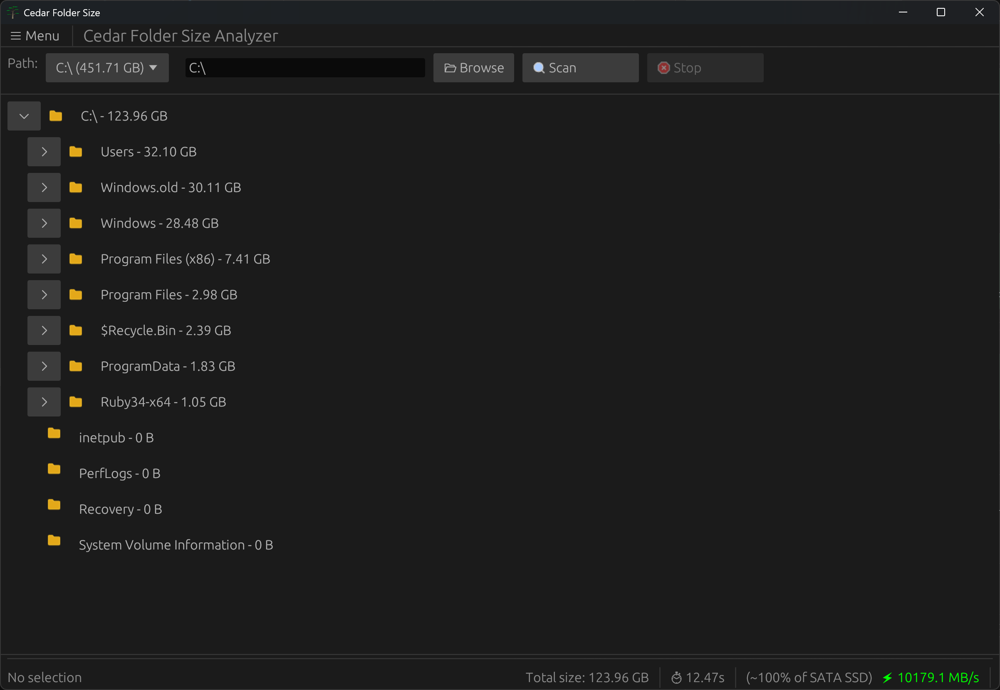
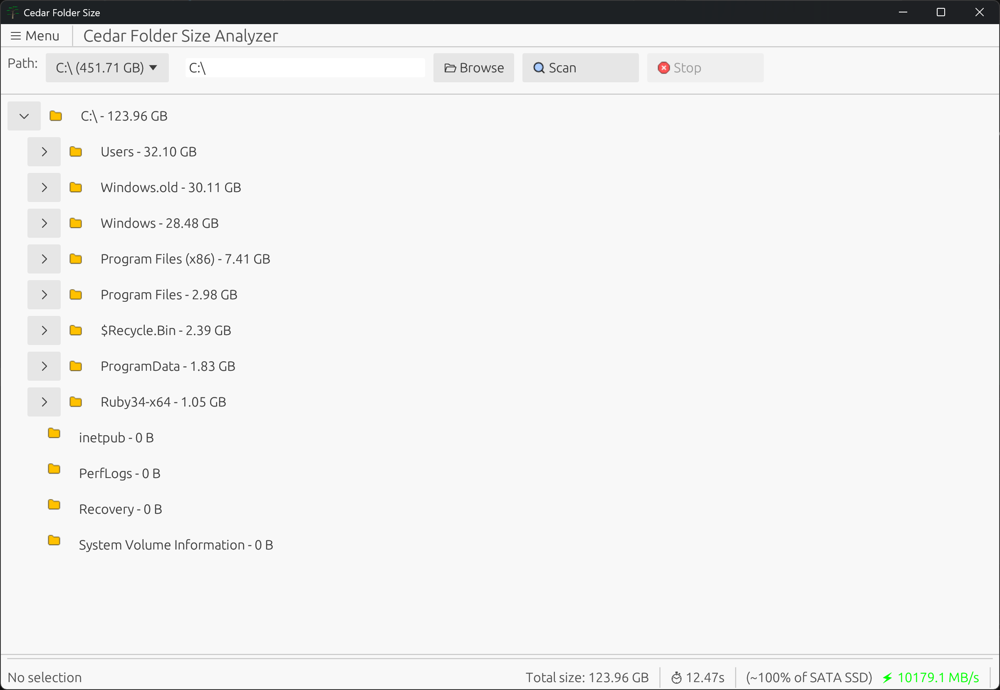

# Cedar Folder Size Analyzer 🌲

<p align="center">
  
</p>

A folder and disk size analyzer for Windows and Linux, written in Rust. A convenient tool for visualizing disk space usage with a tree structure.

[🇷🇺 Русская версия / Russian version](README_RU.md)





## Features

- 📊 Scan disks and folders
- 🌲 Tree view display of directory structure (files and folders)
- 📏 Display folder and file sizes
- 🔍 Sort by size (largest to smallest)
- 🖥️ Support for all available drives (Windows and Linux)
- 💾 Display disk size and type (SSD/HDD)
- ⚡ Adaptive multithreading (SSD - parallel, HDD - single-threaded)
- ⏹️ Ability to stop scanning at any time
- 📈 Detailed progress bar with process information
- 🚀 Scan speed and efficiency analysis
- 🌙 Dark and light themes (auto-detect system theme)
- 🌍 Multilingual support (6 languages: EN, RU, DE, ZH, ES, FR)
- 💾 Auto-save settings (theme, language, last path)
- 🗑️ Safe file and folder deletion to Recycle Bin/Trash (Windows and Linux)
- 📂 Open folders in Explorer
- 📋 Copy paths to clipboard
- 🎨 Modern GUI based on egui with Phosphor icons

## Installation and Running

### Option 1: Install via MSI (recommended)

1. Download the latest version `cedar-folder-size-analyzer-<version>-x86_64.msi` from [Releases](https://github.com/OrelSokolov/cedar-folder-size-analyzer/releases)
2. Run the installer and follow the instructions
3. The application will be installed to `C:\Program Files\Cedar\`
4. Optionally add to PATH for command-line access

> **Note:** Releases are automatically built via GitHub Actions when tags are created. See [GITHUB_CI.md](GITHUB_CI.md) for details.

### Option 2: Build from source

**Requirements:**
- Rust 1.70 or higher
- Windows 10/11 or Linux

```bash
# Clone the repository
git clone https://github.com/yourusername/cedar-folder-size-analyzer.git
cd cedar-folder-size-analyzer

# Build the project
cargo build --release

# Run the application
cargo run --release
```

### Option 3: Create MSI installer

**Requirements:**
- Rust 1.70 or higher
- Windows 10/11
- WiX Toolset (included in project in `wix-tools/` folder)

**Build steps:**

```bash
# 1. Build the release version
cargo build --release

# 2. Compile WiX file to object file
.\wix-tools\candle.exe -nologo -arch x64 -ext WixUIExtension wix\main.wxs `
  "-dCargoTargetBinDir=target\release" `
  "-dVersion=0.1.0" `
  -out target\wix\main.wixobj

# 3. Create MSI installer
.\wix-tools\light.exe -nologo -ext WixUIExtension -ext WixUtilExtension `
  -out target\wix\cedar-folder-size-analyzer-0.1.0-x86_64.msi `
  target\wix\main.wixobj
```

The finished MSI installer will be located at `target\wix\cedar-folder-size-analyzer-0.1.0-x86_64.msi`

> **Note:** If you modified `src/icons/cedar.svg`, run the icon converter to update `wix/Product.ico`:
> ```bash
> cd icon_converter
> cargo run --release
> cd ..
> ```

**Installer features:**
- ✅ Install to `C:\Program Files\Cedar\`
- ✅ Create Start Menu shortcut
- ✅ Optional desktop shortcut
- ✅ Optional PATH addition
- ✅ Built-in application icon
- ✅ Simple uninstallation via "Programs and Features"

## Usage

### 1. **Select path to scan:**
   - Choose a drive from the dropdown list (displays size and type)
   - Or enter a path manually
   - Or use the "📂 Browse" button to select a folder

### 2. **Start scanning:**
   - Click the "🔍 Scan" button
   - The program will automatically detect the disk type and select optimal mode:
     - **SSD** → Multithreaded scanning (faster)
     - **HDD** → Single-threaded scanning (optimal for mechanical drives)
   - Monitor progress in real-time:
     - Number of scanned files and directories
     - Current path being processed
     - Total size of found data
     - Disk type and number of threads
   - Click "⏹ Stop" to interrupt scanning if needed



### 3. **Tree navigation:**
   - Click the `+` button to expand or `−` to collapse folders
   - **Single click** on a folder to select
   - **Double click** on a folder to expand/collapse
   - **Right click** for context menu:
     - 🗑 Delete to Recycle Bin (safe deletion)
     - 📂 Open in Explorer
     - 📋 Copy path
   - Hover over an item to view the full path





### 4. **Interpreting results:**
   - Folders are displayed with 📁 icon (always, even if empty)
   - Files are displayed with 📄 icon
   - Sizes are shown in human-readable format (KB, MB, GB, TB)
   - Items are sorted by size (largest to smallest)
   - Folders with content are automatically expanded
   - At the bottom displays:
     - Total size of scanned data
     - Scan time
     - Scan speed (⚡ in MB/s)

### 5. **Settings:**
   - **☰ Menu** → **Switch theme** (🌙 dark / ☀ light)
   - **☰ Menu** → **Language** (English, Русский, Deutsch, 中文, Español, Français)
   - **☰ Menu** → **About** (application information)
   - Settings are saved automatically

## Technologies

- **egui** - cross-platform GUI framework
- **rayon** - parallel data processing
- **sysinfo** - retrieve disk information (size, type SSD/HDD)
- **rfd** - native file selection dialogs

## Project Structure

```
cedar-folder-size-analyzer/
├── src/
│   ├── main.rs          # Main application code
│   ├── i18n.rs          # Internationalization system
│   └── icons/           # SVG icons (cedar, folder, file, search, stop)
├── languages/           # Translation files (en, ru, de, zh, es, fr)
├── wix/                 # Files for creating MSI installer
│   ├── main.wxs         # WiX configuration
│   ├── License.rtf      # License agreement
│   └── Product.ico      # Application icon (generated from cedar.svg)
├── wix-tools/           # WiX Toolset (candle.exe, light.exe)
├── icon_converter/      # Utility for converting SVG to ICO
├── build.rs             # Build script (embedding icon in EXE)
├── Cargo.toml           # Project dependencies and settings
└── README.md            # Documentation
```

## 🔄 CI/CD and Releases

The project uses GitHub Actions for automatic release building:

- ✅ Automatic build when tags are created
- ✅ MSI installer
- ✅ ZIP archive with executable
- ✅ Automatic GitHub Releases creation

**Quick start - creating a release:**

```powershell
# Automatically (recommended)
.\scripts\create-release.ps1 -Version 0.2.0

# Or manually
git tag -a v0.2.0 -m "Release version 0.2.0"
git push origin v0.2.0
```

GitHub Actions will automatically build and publish the release with artifacts.

**Documentation:**
- 🚀 [QUICKSTART.md](QUICKSTART.md) - Quick start guide
- 📖 [GITHUB_CI.md](GITHUB_CI.md) - Detailed CI/CD documentation

## Future Development

- [ ] Treemap visualization
- [ ] Export results to file
- [ ] Filter by file types
- [ ] Scan history
- [ ] Tree search
- [ ] Settings (exclude folders, depth limits)
- [ ] Port to Linux and macOS

## License

Freeware - free software for personal and commercial use.

## Author

Oleg Orlov (orelcokolov@gmail.com) - 2025

